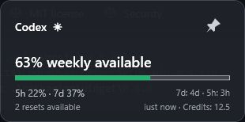
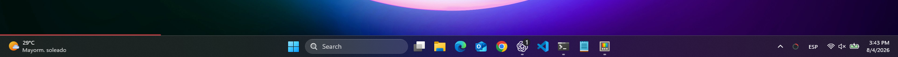
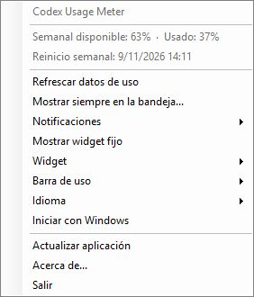
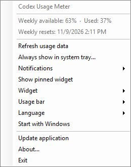

# Codex Usage Meter for Windows

[](https://github.com/aesgalexis/codex-usage-meter-windows/actions/workflows/ci.yml)
[](LICENSE)
[](https://github.com/aesgalexis/codex-usage-meter-windows)

See how much Codex usage you have left without interrupting your work. Codex Usage Meter puts your latest five-hour and weekly availability in the Windows tray, with optional desktop widgets and a thin usage bar above the taskbar.

It reads usage from local Codex sessions and available resets through your installed Codex client. The meter requests no password or API key and includes no analytics or telemetry.

| Normal widget | Compact widget |
| --- | --- |
|  |  |



Widget and menu screenshots use synthetic usage data, not real account or session information.

## Installation

### WinGet

Install from the Windows Package Manager community catalog:

```powershell
winget install CodexUsageMeter
```

To upgrade an existing installation:

```powershell
winget upgrade CodexUsageMeter
```

WinGet matches this query against the package name and ID. If multiple packages match, use the full package ID shown by `winget search CodexUsageMeter`.

New releases appear in WinGet after the catalog update is accepted; the GitHub downloads are available immediately.

### Installer or portable ZIP

Download and run the [latest Windows installer](https://github.com/aesgalexis/codex-usage-meter-windows/releases/latest/download/CodexUsageMeter-Setup-win-x64.exe). It installs per user, requires no administrator privileges, and keeps a stable location for future upgrades. A [portable ZIP](https://github.com/aesgalexis/codex-usage-meter-windows/releases/latest/download/CodexUsageMeter-win-x64.zip) is also available.

Published builds require **Windows 10 build 17763 or later, or Windows 11, x64**. They are self-contained and include .NET 10, so the destination PC does not need the .NET runtime installed. Platform support follows Microsoft's support policy; these requirements do not imply testing on every Windows release.

Codex is not an installer dependency. The app can start without it and waits for local usage snapshots. To display usage, run at least one recent task in Codex or the Codex extension for Visual Studio Code, which writes compatible local session data.

> [!IMPORTANT]
> This is an early development version. The app reads rate-limit snapshots written by Codex to local session files. That file format is not a documented public API and may change in future Codex versions.

## Features

- **Limits at a glance:** five-hour and weekly availability, reset countdowns, credit balance, and available reset credits.
- **Flexible displays:** normal or compact widgets you can pin and drag, plus an independent taskbar usage bar with display and thickness controls.
- **Responsive updates:** near-immediate session-change refreshes, a 30-second fallback refresh, and local activity shine effects.
- **Weekly notifications:** configurable integer percentage changes, 50/75/90% usage thresholds, and resets, with saved preferences. Percentage-change notifications are disabled by default on new installations.
- **Windows integration:** optional startup with Windows and a stable tray identity that lets Windows retain your icon visibility choice across upgrades.
- **Language and updates:** English and Spanish with immediate switching, plus download, verification, installation, and relaunch of the latest stable release when requested from the tray menu.

## Using the app

The app has no main window. Look for the circular indicator next to the Windows clock; it may initially appear under the hidden-icons arrow.

On a new installation, the widget is disabled and the three-pixel usage bar is enabled. Left-click the tray icon for a weekly-usage balloon; right-click to open the menu.

For keyboard access, press **Windows+B**, use the arrow keys to select the tray icon, and press **Enter** or **Space** to perform its primary action. Open its menu with the **Menu** key or **Shift+F10**.



### Which limit each display uses

| Display | Limit shown |
| --- | --- |
| Tray icon | Rolling five-hour availability; falls back to weekly if five-hour data is unavailable. |
| Tray tooltip | Both five-hour and weekly availability. |
| Tray menu status and reset, left-click balloon | Weekly limit. |
| Widget percentage and progress | Weekly availability; both widget modes also show the five-hour reset countdown when available. |
| Normal widget details | Weekly and five-hour reset countdowns, plus separate credit balance and available-reset count. |
| Taskbar usage bar | Weekly availability, with a white marker for five-hour availability. |
| Notifications | Weekly percentage changes, usage thresholds, and resets. |

Missing window values appear as **—**. If Codex reports only the five-hour window, weekly displays remain unavailable and weekly notifications wait for weekly data; the app does not substitute the five-hour percentage for a weekly limit.

Green, amber, and red follow each display's limit independently, so the tray icon and weekly bars can have different colors. Indicators turn purple when local data reports a positive credit balance with credits available and an exhausted usage window. Credits are shown as a balance, not as a number of resets.

The normal card shows available resets separately from the credit balance; the compact widget includes both in its tooltip. The count comes from the installed Codex client's current signed-in account through its read-only app-server interface. It refreshes when the card opens and at most once per minute while visible. If Codex or this information is unavailable, the meter shows **Available resets: no data**, rather than zero. A failed refresh marks a retained count as stale. The meter never redeems resets.

### Widgets and usage bar

Choose **Widget → Normal** or **Compact** for a detailed card or a minimal capsule, or **Disabled** to turn the widget off. Left-click the tray icon to open an enabled widget or close an unpinned one. An unpinned widget also closes when you click outside it or press Escape; moving the pointer does not open or close it.

Pin either design to keep it visible, then drag it anywhere on the desktop; its position is restored next time. If a display is disconnected or the saved position is off-screen, the widget returns to a visible working area. The compact capsule uses its entire width as the weekly-availability bar and includes an integrated pin and five-hour reset countdown. Both designs show monochrome model symbols: a sun for Sol, a moon for Luna, and a circle for Terra.

The compact bar shines when it opens and on local session writes. Activity detection combines session task-state events with local runtime-write metadata to stay responsive during Codex runs; it does not inspect conversation content.

Interrupted activity expires after ten minutes without session writes, including when the task-start event has left the inspected session tail.

**Usage bar** independently controls the non-interactive line immediately above the taskbar. It starts at the left edge, shortens from the right as weekly availability falls, and shines more brightly while Codex is working. Set its thickness from one to five pixels and choose automatic placement near the notification area, a specific detected display, or every display. It works with either widget design or with widgets disabled.

The line stays above normal and maximized browser windows while the taskbar is visible, hides for full-screen videos and applications on its display, and reappears without taking keyboard focus. Mouse clicks pass through to the application beneath it. A small window over a still-visible full-screen video keeps the line hidden; normal windows that fully cover the video allow it to reappear.

### Tray controls and troubleshooting

- **Refresh usage data:** rereads local data without checking for app updates. If no data is available, run a Codex task and refresh.
- **Notifications:** enable or disable weekly percentage changes, individual warning thresholds, and reset notices.
- **Always show in system tray...:** opens the Windows taskbar setting where you can move the icon out of the hidden-icons menu.
- **Start with Windows:** optionally launch the meter at sign-in.
- **About:** shows the installed version, privacy model, project links, license context, and unatomo attribution.
- The right-click menu also lets you pin or hide the widget and exit the app.

The app reads sessions from `%CODEX_HOME%\sessions` when `CODEX_HOME` is set to a non-empty path, otherwise from `%USERPROFILE%\.codex\sessions`. Restart the meter after changing the environment variable so it inherits the new value.

### Languages

The tray menu and usage displays support English and Spanish, with immediate switching from the language submenu. Interactive installers offer both languages; portable and silent WinGet installations use the Windows display language on first run. Your selection is preserved across upgrades.



### Updating the app

Choose **Update application** to check GitHub for a newer stable release, download it, verify its SHA-256 checksum, and install it silently. The app closes and reopens automatically, with no confirmation or installer buttons to press.

Installed copies keep their installation folder and settings. Portable copies are closed and the new version starts from the standard installation folder; the original portable files are kept.

If the portable copy was registered to start with Windows, updating it through the tray menu moves that registration to the installed copy. Updates preserve the enabled or disabled startup choice, and uninstall removes only the startup registration belonging to the copy being removed.

If no update is available or an error occurs, the app reports it with a non-blocking tray notification. Download and verification failures leave the current app running; an installer failure attempts to reopen the previous copy.

Abandoned update download directories older than 24 hours are cleaned up on a later app start. Cleanup is limited to this app's temporary update directories.

## Privacy and security

- No OpenAI password, API key, or ChatGPT token is requested.
- Session contents and usage values never leave the computer.
- Reading the available-reset count uses the installed Codex app-server and its existing sign-in. Codex may contact OpenAI to fetch that account metadata. The meter does not read credential files, send local session contents, start a login, or redeem a reset. App-server analytics are disabled for this query. When the card is hidden, no reset-count queries are started.
- Checking for app updates contacts GitHub only when requested. Downloads come from this project's releases and are verified against the SHA-256 checksum provided by GitHub.
- This project does not include its own analytics or telemetry.
- The optional start-with-Windows setting is stored in the current user's standard Windows `Run` registry key.
- Notification preferences are stored in `%LOCALAPPDATA%\CodexUsageMeter\settings.json`.

See [SECURITY.md](SECURITY.md) for vulnerability reporting.

## Development

Development requires Git and the [.NET 10 SDK](https://dotnet.microsoft.com/download/dotnet/10.0). Published app requirements and everyday controls are covered in [Installation](#installation) and [Using the app](#using-the-app).

### How it works

Codex writes session events below its home directory's `sessions` folder. `CodexHomeResolver` uses an explicit provider path first, then a non-empty `CODEX_HOME`, then `%USERPROFILE%\.codex`. The session provider and activity watchers use the same resolved home. The app searches recent `.jsonl` session files, reads only their tail, and extracts the latest `rate_limits` snapshot. It does not read the files to reconstruct conversations.

```text
Codex local sessions
        ↓
CodexSessionUsageProvider
        ↓
UsageSnapshot
        ↓
Windows tray indicator, widgets, and taskbar usage bar
```

The provider compares event timestamps across recent sessions rather than trusting file modification order. It reads both `primary` and `secondary` rate-limit windows and identifies them by duration. The tray icon uses the five-hour window when available, falling back to a real weekly window; widget progress, the taskbar line, tray menu status, and notifications use only a real weekly window. A missing weekly window remains unknown. The tooltip, taskbar marker, and widget countdown expose five-hour data separately.

Temporary read failures retain the last valid value and mark it as stale. Retained local session files can still provide usage data after Codex is removed; uninstalling Codex does not guarantee the meter returns to an empty state.

The reader is isolated behind an `IUsageProvider` interface so it can be replaced if OpenAI publishes a suitable supported API. See the implemented [localization plan](docs/localization-plan.md) for language resolution and verification details.

Available resets use the separate `IResetCreditProvider`. `CodexResetCreditProvider` starts a hidden `codex app-server --stdio` process, initializes the protocol, reads `account/rateLimits/read`, and closes that process. Only `rateLimitResetCredits.availableCount` is used; the number of detail rows and the currency credit balance are not substitutes. The executable is resolved from `PATH` or the standard Codex desktop installation folders. The query has a ten-second timeout and inherits the same `CODEX_HOME` as the session reader. See the [official app-server protocol](https://learn.chatgpt.com/docs/app-server#6-rate-limits-chatgpt).

### Build and verify

Clone and run:

```powershell
git clone https://github.com/aesgalexis/codex-usage-meter-windows.git
cd codex-usage-meter-windows
dotnet run --project .\src\CodexUsageMeter.App\CodexUsageMeter.App.csproj
```

Build and verify:

```powershell
dotnet build .\CodexUsageMeter.sln --configuration Release
dotnet run --project .\tests\CodexUsageMeter.Tests\CodexUsageMeter.Tests.csproj --configuration Release
```

The automated checks use synthetic fixtures for session parsing, data-state regressions, notifications, configuration, and update handling, with a native tray-icon smoke check. On an interactive Windows desktop, add `-- --window-checks` to the test command to also verify that hiding and showing the usage line preserves the active window, passes mouse input through, and prevents mouse activation. These checks complement manual use; they do not establish that every Windows, display, or Codex-client combination works.

Create a self-contained portable build:

```powershell
dotnet publish .\src\CodexUsageMeter.App\CodexUsageMeter.App.csproj `
  -p:PublishProfile=win-x64 `
  --output .\artifacts\win-x64
```

Follow the [release checklist](docs/release-checklist.md) for installer checks, screenshots, native and manual validation, version consistency, and WinGet submission. The installer checks must run in a clean, disposable Windows profile or CI because they install the app and change startup registration.

Generate manifests from the exact installer intended for release:

```powershell
.\tools\New-WinGetManifest.ps1 -Version 0.8.0 `
  -InstallerPath .\artifacts\CodexUsageMeter-Setup-win-x64.exe
winget validate --manifest .\packaging\winget\0.8.0
```

### Project structure

```text
src/
  CodexUsageMeter.App/             WPF application and tray integration
  CodexUsageMeter.Core/            Stable models and provider contract
  CodexUsageMeter.Infrastructure/  Local Codex session reader
tests/
  CodexUsageMeter.Tests/           Dependency-free parser/provider checks
```

### Roadmap and contributing

- Optional corner snapping and widget appearance controls.
- Native Windows toast notifications and richer scheduling controls.
- Background update notifications.
- ARM64 builds.
- Additional usage providers if a supported API becomes available.

Ideas and contributions are welcome. Read [CONTRIBUTING.md](CONTRIBUTING.md) before opening a pull request.

## Disclaimer

This is an independent open-source project and is not an official OpenAI product. Codex and OpenAI are trademarks of OpenAI.

## License

Distributed under the [MIT License](LICENSE).
